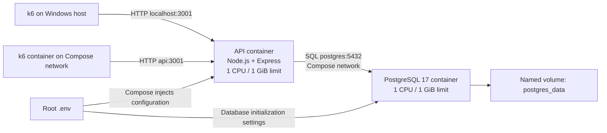
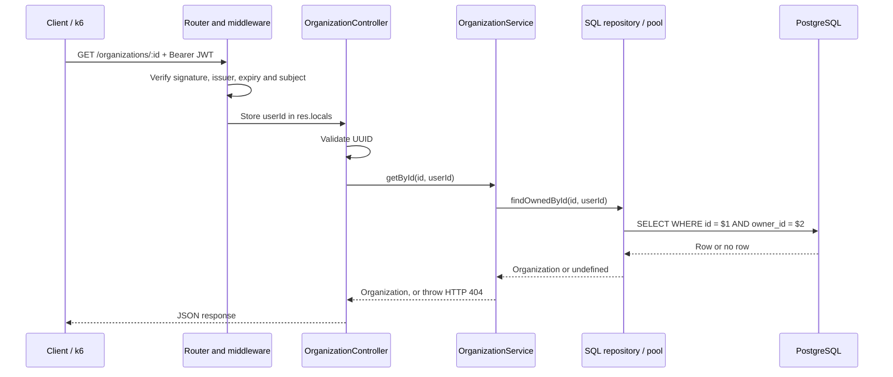
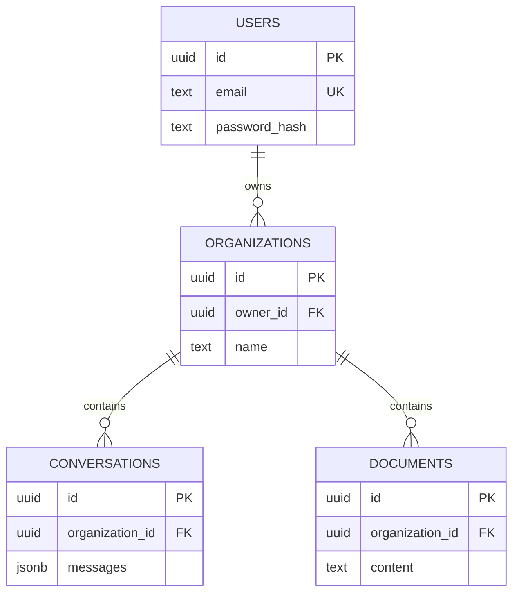

# Version 0 architecture

## What this project implements

The running application is a **modular monolith**: one Express API process with feature modules for authentication, organizations, conversations, and documents, backed by one PostgreSQL database. Feature modules are code boundaries inside the same deployment, not separate microservices.

The API stores submitted messages and document text. It does not yet call an AI model, generate replies, parse uploaded documents, or build a vector search index. The application name describes its intended domain; the implemented endpoints determine its current capabilities.

The repository uses npm workspaces and shared packages for TypeScript configuration, lint configuration, and UI components. `apps/docs/0_Version/Endpoints.md` is an existing endpoint note. At the time of inspection, `apps/docs` has no application package or running Next.js server; the load experiment involves only the API and PostgreSQL.

## Deployment view

Docker Desktop runs Linux containers through WSL2 on this Windows machine. Both native k6 and the Docker-network generator share the same physical computer as the server, so the load generator, virtualization, background tasks, and server can compete for host resources. The two generator placements are separate experiments; they bypass different network layers. Per-container CPU and RAM caps are upper bounds; the Docker/WSL environment has a separate overall resource pool.

Compose resolves `postgres` as the database service name on its network. `localhost` inside the API container would identify the API container itself. Native Windows development instead uses the database's published host port.

The working Compose file during the experiment had a pre-existing, locally modified PostgreSQL host mapping of `5432:5433`. The database listens on container port **5432**, so that mapping does not expose its real listening port to a native host client. Docker API-to-database traffic still works through `postgres:5432`, which is why this load experiment works. For host database access, use `127.0.0.1:5432:5432`, the repository's original mapping. The user's local mapping was preserved in the workspace and is not introduced by the documentation commit.

Source: [compose.yaml](../../compose.yaml).

## How one organization read works

The controller handles HTTP input and output. The service applies application rules, such as turning a missing row into a 404. The repository owns SQL and database result mapping. This separation lets a feature's SQL or business rules change without placing every concern in a route handler.

Read the code in this order:

1. [Application composition](../../apps/api/src/app.ts).
2. [Organization routes](../../apps/api/src/modules/organizations/organization.routes.ts).
3. [Authentication middleware](../../apps/api/src/middleware/authenticate.ts).
4. [Organization controller](../../apps/api/src/modules/organizations/organization.controller.ts).
5. [Organization service](../../apps/api/src/modules/organizations/organization.service.ts).
6. [Organization repository](../../apps/api/src/modules/organizations/organization.repository.ts).
7. [Database connection pool](../../apps/api/src/database/database.ts).

## Data model

The diagram highlights keys and relationships rather than every column. [schema.sql](../../apps/api/src/database/schema.sql) defines the complete model.

Primary keys identify rows; foreign keys prevent references to missing users or organizations. The unique email constraint prevents duplicate registrations even when concurrent requests race. PostgreSQL's unique violation `23505` becomes HTTP 409. Indexes exist on ownership and organization relationships; a read by organization ID also benefits from the primary-key index.

Conversations use JSONB for submitted messages, while organizations and ownership remain relational. This simplifies the MVP, but a whole message history in one column is a different storage tradeoff from individually indexed message rows.

## Security boundary

Registration hashes passwords with a random salt and asynchronous scrypt. Login verifies the derived hash with a timing-safe comparison. Passwords are never returned in the normal auth response.

The API signs HS256 JWTs with a configured secret. Tokens identify a user using the `sub` claim, include the expected issuer, and expire after seven days. Signature verification authenticates the user; ownership predicates in SQL authorize access to a specific resource. Those are different checks.

Conversation reads join organizations to verify ownership. Conversation/document creation uses `INSERT ... SELECT` with the organization ID and owner ID in the same statement. This avoids a separate ownership lookup followed by an unchecked insert. Inaccessible resources return 404, just like absent ones.

JSON bodies are limited to 1 MiB and validated at runtime. Typed request bodies alone would not protect against malformed external input. The centralized error handler produces controlled 400, 401, 404, 409, 413, and 500 responses.

## Execution and persistence

[server.ts](../../apps/api/src/server.ts) validates configuration, creates a connection pool, initializes the schema, and binds the HTTP server to `0.0.0.0`. The schema uses `CREATE TABLE/INDEX IF NOT EXISTS`; this preserves existing data but is not a full versioned migration strategy.

The API runs one Node.js process. Asynchronous database calls allow many requests to be in progress while I/O completes. JavaScript execution still competes for the process's event loop; synchronous JWT verification, JSON work, and callbacks consume CPU. Scrypt uses asynchronous crypto work. Additional CPU capacity does not automatically turn this process into multiple HTTP workers. [Node.js event loop explanation](https://nodejs.org/learn/asynchronous-work/event-loop-timers-and-nexttick)

The `pg` pool reuses database connections. This code does not customize its size, so the library's default maximum of 10 clients applies. More HTTP users do not imply one database connection per user. When all pool clients are busy, pending work waits. A production connection budget must account for every API replica. [node-postgres pool configuration](https://node-postgres.com/apis/pool)

PostgreSQL stores data in a named Docker volume. Recreating a container retains the data in that volume; removing the volume destroys that persistence. `restart: unless-stopped` restarts containers when appropriate, but is not a highly available deployment or a backup strategy. PostgreSQL's health check gates API startup; the API currently has no dedicated readiness/health endpoint.

## Build and shutdown

The [Dockerfile](../../apps/api/Dockerfile) uses a build stage to install dependencies and compile TypeScript. The runtime stage installs production dependencies, copies compiled code, and runs as the non-root `node` user. The API process is launched with `node apps/api/dist/server.js`; it is not the watch-mode development process.

On SIGTERM or SIGINT, the server stops accepting new connections, attempts to close the database pool, and has a ten-second shutdown timeout. This improves ordinary container restarts, but safe shutdown under long requests still needs testing.

## Current constraints and possible next steps

Version 0 has no reverse proxy or TLS termination, application cache, rate limiter, job queue, multiple API replicas, database replica, distributed tracing, or automated backup procedure in the inspected deployment. The k6 experiment does not claim these features exist.

Possible next steps depend on evidence:

- If CPU throttling and latency rise together, investigate CPU-heavy request work and compare more CPU or additional API workers/replicas.
- If the pool is saturated, measure SQL latency and pool waiting before increasing connections; the database must support the combined budget.
- If repeated reads dominate, investigate caching and its invalidation/authorization requirements.
- If document processing or AI calls are added, consider queued background work, external-call deadlines, and failure/retry behavior.
- Before production operation, add versioned migrations, readiness checks, structured request metrics, backups with restore tests, and secure ingress.

These are proposals, not implemented capabilities or changes made by this experiment.
