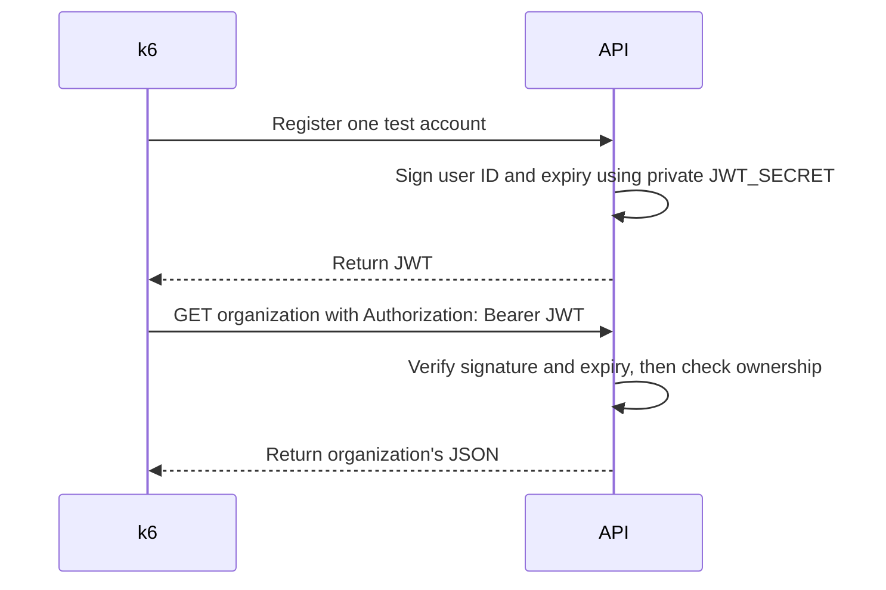

# Learn to read this project's load tests

Start here, then open [the full results](testResult.md) and [the architecture](architecture.md).

## Why JWT_SECRET does not match the token

`JWT_SECRET` is a private key used by this API to sign and verify JWTs with HS256. A JWT is the signed login credential returned by registration or login. They are different values and must not match. This API's JWT contains the user's ID (`sub`), issuer (`iss`), creation time (`iat`), and expiry (`exp`), and normally expires after seven days. Its contents are encoded, not encrypted; the signature prevents changing the claims without the signing key.



The load test needs the JWT in memory to make authenticated requests. The test account is artificial, but its credential grants real access to that account's resources while valid. That is why GitGuardian correctly detected it. The old `--summary-export` included `setup_data`, which accidentally saved the test's JWT. The corrected export saves only numerical metrics and threshold failure flags. Do not commit JWTs, signing keys, passwords, or `.env` files.

The local signing key was rotated after this exposure; all 15 exposed JWTs were checked and rejected with HTTP 401. New logins produce working JWTs. A signing-key change invalidates every JWT signed with the old key, so users must log in again. Previously committed tokens still exist in Git history. Any other API deployment using that old key needs its own rotation and restart. Do not copy the old placeholder key back into `.env`.

## What the three result folders contain

Each folder is a **campaign**: several separate runs executed sequentially. Each campaign starts with a 1-user, 10-second warm-up, followed by the listed load stages.

| Folder | Load stages | Where k6 runs | What to learn |
| --- | --- | --- | --- |
| [01-windows-10-50-100-250-500-1000-2000-users-30s](results/01-windows-10-50-100-250-500-1000-2000-users-30s/) | 10, 50, 100, 250, 500, 1000, 2000 users; 30s each | Windows, through `localhost:3001` | Gradually increasing traffic; connection refusals appeared in larger stages. |
| [02-docker-500-1000-2000-users-30s](results/02-docker-500-1000-2000-users-30s/) | 500, 1000, 2000 users; 30s each | Docker network, through `api:3001` | Compare the traffic path; these stages had zero failed reads. |
| [03-docker-2000-5000-users-1m](results/03-docker-2000-5000-users-1m/) | 2000, 5000 users; 1 minute each | Docker network | Repeat a passing load for longer, then stress the service until latency fails. |

The original folder names were start timestamps in UTC. The renamed folders identify the traffic instead; exact dates remain in `environment.json` and `runs.json`. Historical commands in those files deliberately keep their original output paths, because that is what actually ran. The suffix `Z` on a timestamp means UTC.

`01-2000vu-1m.summary.json` means stage **01**, **2000 concurrent virtual users**, for **1 minute**. The leading number is execution order, not user count. `00-1vu-10s` is the warm-up. The three files sharing a stage's name are:

| File | Use it for |
| --- | --- |
| `.summary.json` | Exact request counts, rates, latency, checks, and thresholds. |
| `.log` | Console output and actual errors; essential when a stage fails. |
| `.stats.json` | Sampled API/PostgreSQL CPU and RAM usage during that stage. |
| `runs.json` | All stages, their exit codes, start/end times, container state, and CPU counters. |
| `environment.json` | Runtime versions, resource limits, and where the generator ran. |

## Read one successful result

Open Campaign C's [2000-user summary](results/03-docker-2000-5000-users-1m/01-2000vu-1m.summary.json). Find metric names ending in `{operation:organization_read}`; these describe the load phase, excluding account/organization setup.

| Metric | Observed value | Meaning |
| --- | --- | --- |
| `http_reqs` count | 116,623 | Total organization-read requests made during this stage. |
| `http_reqs` rate | 1,918.94/s | About 1,919 reads per second on average. |
| `http_req_duration` `p(95)` | 109.60 ms | 95% of measured HTTP durations were at most about 110 ms. |
| `http_req_duration` `p(99)` | 695.04 ms | The slowest tail matters: 1% exceeded about 695 ms. |
| `http_req_failed` rate | 0 | Zero failed reads. Rate `0.01` would mean 1%, not 0.01%. |
| `checks` rate | 1 | All checks passed; rate `1` means 100%. Each read has two checks. |
| Exit code in `runs.json` | 0 | All configured thresholds passed. |

VUs are concurrent simulated users, not requests per second or unique registered accounts. All VUs in one run share its single test account and organization. Each waits one second after a read, so actual throughput depends on response time. These results cover one small authenticated read endpoint; they do not measure the whole product's traffic.

## Read the failure and connect it to architecture

Compare Campaign C's [5000-user summary](results/03-docker-2000-5000-users-1m/02-5000vu-1m.summary.json). It achieved about **1915 reads/s**, almost the same throughput as 2000 users, but p95 increased to **2341 ms**. The chosen limit was **500 ms**, so the stage failed even though the failed-read rate, **0.484%**, stayed below the 1% limit.

More users with almost unchanged throughput and much longer response times suggests capacity pressure and waiting. The recorded API cgroup CPU throttling supports investigating its one-CPU limit. This is evidence to investigate, not proof that one code function or database setting caused every delay. Read [the CPU measurements and limitations](testResult.md) before changing resources.

When inspecting a summary, a threshold boolean of `true` means **failed** and `false` means **did not fail**. This is the legacy export convention retained by our safe exporter. The console prints explicit PASS/FAIL labels; k6 exit 99 indicates a breached threshold.

Study in this order: user count and duration, failed-read rate, p95/p99, throughput, logs, then CPU/RAM and container state. Ask whether increasing traffic still produces more useful work, whether the latency stays acceptable, and whether errors explain an apparently fast response time. A short passing run is not a production capacity guarantee.

## Run your own small comparison safely

With the Docker API and database running, execute from the repository root:

```powershell
$env:K6_EXECUTION = "docker"
$env:LOAD_USERS = "10,50,100"
$env:LOAD_DURATION = "30s"
npm run test:load:matrix
Remove-Item Env:K6_EXECUTION, Env:LOAD_USERS, Env:LOAD_DURATION
```

The new output folder includes the generator, user counts, duration, and timestamp. The runner exports metrics without credentials. Keep workload, duration, and generator placement constant when comparing a resource change, and read failures alongside latency.
