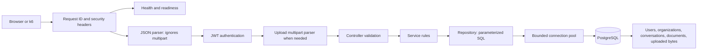
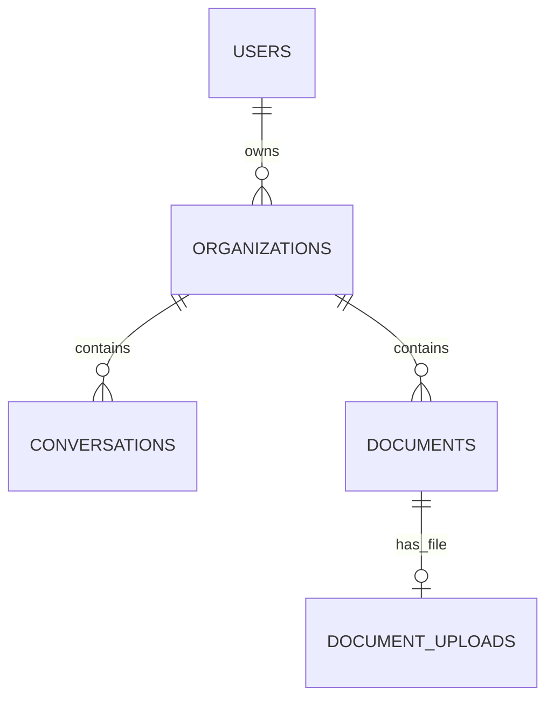

# Version 1 architecture

This is a modular monolith: one Node/Express process contains several business modules. PostgreSQL holds durable data. Docker packages the compiled API and runs PostgreSQL separately. Containers on your laptop still use your laptop's CPU, memory and storage.

The upload order is authentication **before** the multipart parser, so an anonymous caller cannot cause file buffering. Health, registration and login routes do not require JWT authentication. HTTP completion logs and the shared error handler apply across routes.

## Boundaries in the code

| Layer       | Location              | Responsibility                                                 |
| ----------- | --------------------- | -------------------------------------------------------------- |
| Wiring      | `apps/api/src/app.ts` | Construct repositories, services, controllers and routers      |
| Process     | `src/server.ts`       | Connect, migrate, listen, log pool usage and drain on shutdown |
| Environment | `src/config/env.ts`   | Reject missing/invalid startup configuration                   |
| Middleware  | `src/middleware/`     | Request correlation, JWT verification and controlled errors    |
| Module      | `src/modules/<name>/` | Routes → controllers → services → repositories                 |
| Database    | `src/database/`       | Pool, original schema and tracked Version 1 migration          |

Paths beginning with `src/` above are relative to `apps/api`.

Controllers validate unknown request data. Services choose outcomes such as “organization not found.” Repositories combine resource lookup with ownership in SQL; UUID possession alone never authorizes access. Constructors accept dependencies, which lets tests exercise the same layers with isolated databases.

## Routes

| Method | Path                      | Authentication / purpose                                             |
| ------ | ------------------------- | -------------------------------------------------------------------- |
| GET    | `/health/live`            | Public; process responds without querying the database               |
| GET    | `/health/ready`           | Public; bounded database probe, 503 during draining or probe failure |
| POST   | `/register`               | Public; validate and hash password, return user and JWT              |
| POST   | `/login`                  | Public; verify password, return user and JWT                         |
| POST   | `/organizations`          | Bearer token; create an organization owned by this user              |
| GET    | `/organizations/:id`      | Bearer token; read this user's organization                          |
| POST   | `/conversation`           | Bearer token; create in this user's organization                     |
| GET    | `/conversation/:id`       | Bearer token; read an owned conversation                             |
| POST   | `/documents`              | Bearer token; create a JSON text document                            |
| POST   | `/documents/upload`       | Bearer token; upload Text, Markdown or PDF multipart file            |
| GET    | `/documents/:id`          | Bearer token; read owned metadata and stored text                    |
| GET    | `/documents/:id/download` | Bearer token; download an owned uploaded file                        |

## Data relationships

Existing UUID primary keys identify rows. Email has a unique constraint. Foreign keys prevent relationships to nonexistent rows. Version 1 adds checks for nonblank/bounded names and titles, normalized/bounded user emails, password-hash length, conversation message arrays, document text length, accepted file media types and upload byte length.

`document_uploads` stores one optional file per document: `document_id`, filename, media type, byte count and `BYTEA` data. A transaction inserts document metadata and bytes together. Both succeed or neither persists. File deletion cascades when a document is deleted at the database level; the API currently has no delete route.

Files are stored in PostgreSQL for this learning version. This keeps persistence and ownership simple, but growing binary data increases database storage, backups and traffic. The API buffers each upload in memory before validating and writing it. A 1 MiB file limit bounds each individual buffer, not the total memory used by many simultaneous uploads. PDF checks validate the signature/end marker; they do not fully parse, scan or extract PDF content.

## Indexes and pool

PostgreSQL already indexes primary keys and unique email values. The schema also creates `organizations_owner_idx`, `conversations_organization_idx` and `documents_organization_idx` for owner/organization relationships. The upload primary key indexes one-file lookup by document ID. Version 1 retains and verifies these indexes instead of adding duplicate indexes over already indexed IDs. Current ID reads typically benefit from primary keys; relationship indexes become more useful for organization-scoped lists and joins. An index's existence does not prove every query uses it; check a query plan on realistic data.

| Environment variable            | Default | Purpose                                               |
| ------------------------------- | ------- | ----------------------------------------------------- |
| `DB_POOL_MAX`                   | `10`    | Maximum PostgreSQL connections per API process        |
| `DB_POOL_IDLE_TIMEOUT_MS`       | `30000` | Retire unused clients                                 |
| `DB_POOL_CONNECTION_TIMEOUT_MS` | `3000`  | Bound connection acquisition/establishment            |
| `DB_POOL_QUERY_TIMEOUT_MS`      | `5000`  | Client query timeout and PostgreSQL statement timeout |

Transactions borrow one client and release it in `finally`. Thousands of HTTP users share these connections. Multiple API replicas multiply connection demand: four replicas with max ten can open forty connections, before administration or other applications. Raising the pool limit is useful only if PostgreSQL has capacity.

Startup takes a transaction-scoped advisory lock, ensures the base schema exists, checks `schema_migrations`, and applies migration 1 once. Concurrent API startups cannot apply the same migration simultaneously. SQL migration files are copied alongside compiled JavaScript during the Docker build.

## Operations and limits

Every response carries a request ID. Logs contain JSON records with route templates, method, status, duration and selected operational fields. Pool totals, idle clients and waiting callers are logged every ten seconds. Logs exclude bodies, passwords, JWTs, query strings and raw database errors.

Readiness checks PostgreSQL and returns within roughly one second if the probe stalls. Its deadline does not cancel an already queued query; pool/query timeouts separately bound the production query. Liveness avoids making every database incident restart the API. The Docker image healthcheck calls readiness. Docker health status alone does not automatically restart an unhealthy container or provide a load balancer.

Shutdown marks the process as draining, closes the HTTP server and pool, and enforces a ten-second final deadline. Security headers come from Helmet; production HTTPS termination, external rate limits, deployment monitoring and backup operations remain deployment concerns.

Version 1 adds no Redis cache, queue, CDN, horizontal autoscaler or PDF extraction. It provides observable behavior to measure before introducing those components.
