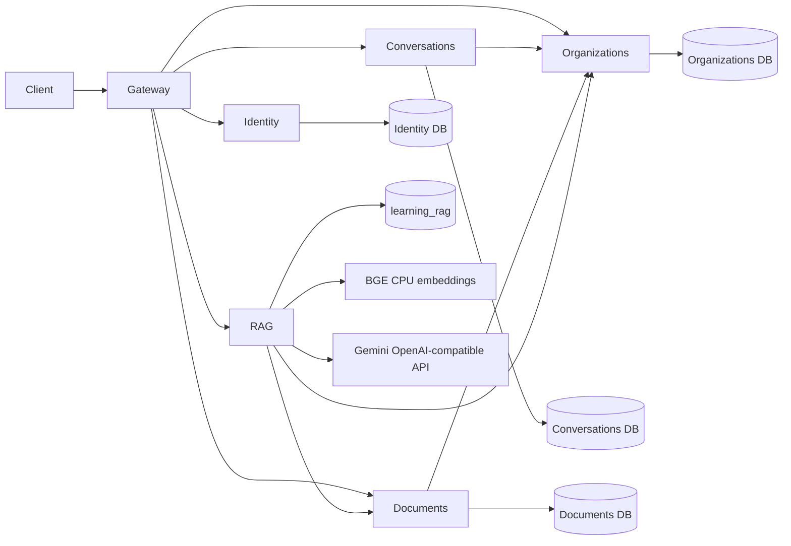

# Stateless services and RAG

[Executed verification results and reproduction commands](microservices-validation.md).

The default Docker stack starts a new application. Existing PostgreSQL data is not copied, reset or deleted. The former `postgres_data` volume remains available; new data uses `microservices_postgres_data`.



| Process | Responsibility | Durable state |
| --- | --- | --- |
| `api` | Streaming HTTP gateway; preserves public route paths | None |
| `identity` | Registration, password hashing, signed JWTs | `identity` database |
| `organizations` | Organization creation and ownership authority | `organizations` database |
| `conversations` | Conversation messages; verifies organization access by HTTP | `conversations` database |
| `documents` | Document content, uploads and downloads; verifies access by HTTP | `documents` database |
| `rag` | Indexing, retrieval, prompt construction, Gemini calls | Qdrant; weights cached separately |

Domain processes share a built Node image and TypeScript modules, but run separately, register only their own routes, and use different PostgreSQL databases and roles. PostgreSQL is initially one server hosting those databases; it remains a shared infrastructure failure domain. There are no cross-database joins or foreign keys. An ownership lookup fails closed if the organizations service is unavailable. Organization owners are currently immutable; adding ownership transfer or deletion requires defining cross-service lifecycle behavior.

JWTs are verified by every service, including Python RAG. No sticky sessions, in-memory chat history, local upload files or per-user process state are required. Upload bytes stay in the documents database. Model weights and connection pools are process resources, not user sessions. All services currently trust the same HS256 signing secret; conversations/documents issue 30-second delegated tokens for organization checks. Use asymmetric verification keys if different services must not be able to mint user tokens.

Four one-shot initialization containers apply the SQL files under `apps/api/src/database/services` before domain services start. These initialize the new databases; they do not migrate old records. Prisma Client maps the domain tables. The unified schema also supports the earlier all-in-one runtime for regression tests; do not run Prisma `db push` against a domain database, since that would create tables owned by other services.

## Start and configure

Keep your existing root `.env`; add the new variables from `.env.example`. Do not commit real keys. Database passwords must be URL-safe. Role passwords initialize on the first boot of the new database volume; editing `.env` later does not change PostgreSQL passwords automatically.

```sh
docker compose up --build -d --wait --wait-timeout 600
```

The first build installs CPU PyTorch and downloads public Hugging Face weights. Later RAG replicas reuse the `embedding_models` volume. To download weights explicitly after building:

```sh
docker compose run --rm --no-deps rag python -m app.download_model
```

Only the gateway publishes the application port (`3001` by default). PostgreSQL's host port follows `POSTGRES_PORT`. Qdrant publishes `127.0.0.1:6335` by default to avoid colliding with another local Qdrant; inside Docker its URL is `http://qdrant:6333`.

Add `api_key=...` (as in the supplied Python snippet) or `GEMINI_API_KEY=...` to `.env` when ready. The default model is exactly `gemini-3.1-flash-lite` and the default `OPENAI_BASE_URL` is `https://generativelanguage.googleapis.com/v1beta/openai/`. Then recreate RAG to load the new environment:

```sh
docker compose up -d --force-recreate rag
```

Search/indexing and the core services work without a Gemini key. `/rag/query` returns a controlled `503` until it is configured. `/rag/health/ready` reports `generationConfigured`. Gateway readiness checks the core services; it deliberately does not require Gemini availability. RAG readiness checks its collection independently.

## RAG requests

First register/login, create an organization and create/upload a document through the existing routes. All RAG routes require the resulting Bearer JWT. Indexing is explicit so a failed embedding call cannot lose a successfully uploaded document.

```text
POST /rag/documents/{documentId}/index
Authorization: Bearer <JWT>
```

```text
POST /rag/search
POST /rag/query
Authorization: Bearer <JWT>
Content-Type: application/json

{"organizationId":"<UUID>","question":"What is our refund policy?","topK":4}
```

Search returns `sources` with document IDs, titles, chunks and scores. Query returns `answer`, `sources` and `model`. The prompt includes retrieved excerpts and asks for numbered citations. Source excerpts are treated as untrusted data; this reduces prompt-injection risk but cannot guarantee model behavior. Responses require application review before being used for automated business actions.

The embedding implementation is `HuggingFaceEmbeddings(model_name="BAAI/bge-small-en-v1.5")` on CPU with normalized vectors. Token-based chunks use 400 tokens with 50-token overlap, within BGE's 512-token context. The collection uses 384-dimensional cosine vectors and is opened with `QdrantVectorStore.from_existing_collection`. A missing collection is created only when `QDRANT_CREATE_COLLECTION=true`; an incompatible existing collection fails startup instead of being overwritten.

Every search applies both `metadata.ownerId` and `metadata.organizationId` filters after checking the organization service. Indexing obtains document content through the documents API using the caller's JWT; clients cannot supply a forged document owner. Existing vectors without these ownership metadata fields will not be returned. PDF indexing supports text extraction, at most 100 pages and 200000 extracted characters; scanned PDFs need OCR, which is not included. The immutable document API and deterministic vector IDs make indexing retries idempotent. Qdrant is a derived index; re-index documents to rebuild it.

## Verification and scaling

```sh
npm run check-types
npm run lint
npm test
npm run build
node --import tsx apps/api/scripts/check-microservices.ts --rag
node --import tsx apps/api/scripts/check-microservices.ts --rag --restart
docker compose run --rm --no-deps rag python -m unittest discover -s tests -p "test_*.py"
```

The Node regression suite retains isolated PostgreSQL schemas. The Docker smoke check exercises separate service databases through the real gateway, including multipart bytes, ownership rejection, real BGE indexing and Qdrant tenant isolation. It never calls paid generation. `apps/rag/tests/check_generation.py` checks the actual generation client against `postman/simulations/rag.sim.yaml`; the stand-in validates the OpenAI-compatible request and returns a completion. This verifies wiring, not Google's model access or answer quality. Google calls remain unverified until the real key is provided.

`--restart` additionally restarts documents and RAG, waits for readiness, and reads the same document and indexed vectors using the original session token. This confirms that those records and the session do not depend on a process surviving.

```sh
docker compose up -d --scale conversations=2 --scale documents=2
```

Service DNS supplies replica addresses; no instance has a fixed container name or published domain port. The gateway makes fresh upstream connections. Each Node replica has its own bounded pool (default 10); plan the total number of connections before scaling beyond PostgreSQL's limit. The model needs memory per RAG replica, even when cached weights are shared. PostgreSQL and Qdrant remain stateful and require backups; stateless API scaling does not make the data stores highly available.

Provider references: [Google OpenAI compatibility](https://ai.google.dev/gemini-api/docs/openai), [BGE model card](https://huggingface.co/BAAI/bge-small-en-v1.5), [Qdrant LangChain integration](https://qdrant.tech/documentation/frameworks/langchain/).
